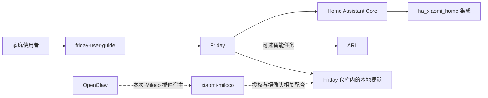

# Friday 项目索引

从一个入口找到 Friday 相关源码、用户手册和外部依赖，并在根目录使用日常服务维护脚本。

- **想使用产品**：先读 [Friday 用户手册](https://lijunfeng722.github.io/friday-user-guide/)。
- **想部署、启动、停止或重新启动服务**：查看[部署、启停与升级总览](docs/operations.md)，从这里找到根目录脚本、操作步骤和验收说明。
- **想维护代码或部署**：从下表进入对应仓库，再看[整体架构](docs/architecture.md)。
- **准备开发、修复或维护文档**：阅读[开发规范](docs/development.md)与 [CONTRIBUTING.md](CONTRIBUTING.md)，使用各仓库的 `AGENTS.md` 或 [Friday 开发 Skill](skills/friday-development/SKILL.md)。
- **想更新索引**：按[维护方式](docs/maintenance.md)核对来源、关系与链接。

## 根目录启停入口

| 操作 | 文件 | 行为 |
| --- | --- | --- |
| 启动 | [start-friday.sh](start-friday.sh) | 启动尚未运行的服务，已运行的服务通过就绪检查后复用 |
| 正常停止 | [stop-friday.sh](stop-friday.sh) | 等待服务和已登记子进程正常收尾 |
| 重新启动 | [restart-friday.sh](restart-friday.sh) | 正常停止后按依赖顺序启动 |
| 初始化与状态检查 | [friday-services.py](friday-services.py) | 使用本机服务清单，提供 `init`、`status` 和模拟运行 |

在已有本机清单的环境中，可于本仓库根目录执行 `./start-friday.sh`、`./stop-friday.sh` 或 `./restart-friday.sh`，追加 `--dry-run` 先看计划。清单默认是同目录的 `services.local.json`；已有清单可通过 `FRIDAY_SERVICE_CONFIG` 指向原文件，新环境按[维护步骤](docs/operations.md#在元仓库根目录使用)初始化。清单、账号与运行数据不提交 Git。

源码和 [SHA256 清单](SHA256SUMS)在这里统一维护；用户手册提供同步生成的下载副本。[原许可证](FRIDAY-SCRIPT-LICENSE.txt)随脚本保留。

## 仓库索引

| 仓库 | 职责 | 类型 | 使用关系 | 详细说明 |
| --- | --- | --- | --- | --- |
| [Friday](https://github.com/Geeprox/Friday) | 家庭产品主仓：Web 界面、设备操作、手势、回看与原生组件 | 主项目 | 核心 | [简介](repos/friday.md) |
| [ARL](https://github.com/Geeprox/ARL) | 共享智能运行服务与原生管理界面 | 相关项目 | 智能能力按需 | [简介](repos/arl.md) |
| [Friday 用户手册](https://github.com/lijunfeng722/friday-user-guide) | 图文手册、GitHub Pages 与部署维护脚本下载副本 | 独立文档 | 使用与部署维护 | [简介](repos/user-guide.md) |
| [Home Assistant Core](https://github.com/home-assistant/core) | 家庭房间、设备、状态和服务的统一接入 | 外部依赖 | 真实家庭接入 | [简介](repos/home-assistant.md) |
| [Xiaomi Home 集成](https://github.com/XiaoMi/ha_xiaomi_home) | 让 HA 接入小米家庭账号与受支持设备 | HA 集成 | HA 接入小米设备时 | [简介](repos/xiaomi-home.md) |
| [Xiaomi Miloco](https://github.com/XiaoMi/xiaomi-miloco) | 小米授权、摄像头与智能服务相关能力 | 外部可选服务 | 按摄像头方案选用 | [简介](repos/miloco.md) |
| [OpenClaw](https://github.com/openclaw/openclaw) | 本次选用的 Miloco 插件宿主平台 | 可选宿主 | 选择该 Miloco 部署方案时 | [简介](repos/openclaw.md) |

## 先记住的关系

**Xiaomi Home 集成装在 Home Assistant 内部。** Miloco、ARL 与 OpenClaw 有各自的服务职责；并不是为了打开 Friday 就必须启动所有可选功能。

Friday 的人体和手势代码位于 Friday 仓库。Miloco 能播放摄像头视频，不等于 Friday 的本地识别环境已经准备好。图文手册单独维护，站点提供文档、示例截图与维护脚本下载。

## 部署与维护入口

| 要做什么 | 从哪里开始 |
| --- | --- |
| 从零安装 macOS / Linux 环境 | [安装总览](https://lijunfeng722.github.io/friday-user-guide/getting-started/installation/) |
| 正常停止、重新启动和查看状态 | [启停使用步骤](https://lijunfeng722.github.io/friday-user-guide/getting-started/installation-maintenance/#1-日常启动与停止) |
| 电脑重新开机后恢复服务 | [整机重启恢复与旧进程记录处理](docs/operations.md#电脑重启后的恢复) |
| Miloco 启动报错，稍后又能打开页面 | [较慢启动的就绪等待](docs/operations.md#miloco-冷启动的等待) |
| 多人入镜时手势无响应或需要切换操作者 | [明确选择操作者](docs/operations.md#多人镜头中的操作者选择) |
| 张开有响应、紧接着合上却未完成 | [连续手势与设备回读](docs/operations.md#连续手势与设备回读) |
| 查找依赖安装器的源码与修复提交 | [Friday 安装器](https://github.com/Geeprox/Friday/blob/main/scripts/setup-dependencies.py) · [修复提交 4ecf56c](https://github.com/Geeprox/Friday/commit/4ecf56c6a515f1fe1d6494e3632a2257490353ad) |
| 查找启停源码与校验清单 | [根目录入口](#根目录启停入口) · [文档站下载副本](https://github.com/lijunfeng722/friday-user-guide/tree/main/docs/assets/scripts) |
| 升级已有 Xiaomi Home，处理重启后的设备不可用 | [升级与排障说明](docs/operations.md) |
| 了解本轮修改、版本与验收范围 | [2026-11-01 维护记录](docs/operations.md#本轮维护与验收记录) |

安装器修复已推送到 `Geeprox/Friday` 的 `main`；本元仓库维护日常启停源码、测试和总入口，`friday-user-guide` 保留工具下载副本与教程，GitHub Pages 提供文档阅读和下载。每台机器的 `services.local.json`、账号授权、家庭数据、备份及原始日志保存在本机私有目录。



## 目录

```text
friday-project-index/
├── README.md
├── AGENTS.md              # 本仓库入口与公共开发约定
├── CONTRIBUTING.md        # 开发协作入口
├── start-friday.sh         # 启动已有部署
├── stop-friday.sh          # 正常停止
├── restart-friday.sh       # 正常停止后重新启动
├── friday-services.py      # 服务管理程序
├── SHA256SUMS             # 启停工具与许可证校验
├── FRIDAY-SCRIPT-LICENSE.txt # 保留的工具许可证
├── repos.json
├── skills/                # 集中维护的技能源码
│   └── friday-development/ # 开发 Skill、界面元数据与规范副本
├── .github/               # PR 模板、固定约定快照和检查工作流
├── repos/                 # 每个仓库一页简介
├── docs/
│   ├── architecture.md    # 整体关系与部署边界
│   ├── operations.md      # 部署、启停、升级与验收入口
│   ├── maintenance.md     # 怎样保持索引正确
│   └── development.md     # 公共开发规范的维护源
└── scripts/               # 索引检查、规范/下载同步及隔离测试
```

索引核对日期：**2026-11-01**。上游版本和支持范围以各原仓库及其官方说明为准；本索引不代表每一项能力均已完成现场验收。
