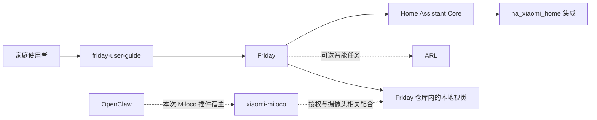

# Friday 项目索引

从一个入口找到 Friday 相关源码、用户手册和外部依赖，并理解它们之间的分工。

- **想使用产品：**先读 [Friday 用户手册](https://lijunfeng722.github.io/friday-user-guide/)。
- **想维护代码或部署：**从下表进入对应仓库，再看[整体架构](docs/architecture.md)。
- **想更新索引：**按[维护方式](docs/maintenance.md)核对来源、关系与链接。

## 仓库索引

| 仓库 | 职责 | 类型 | 使用关系 | 详细说明 |
| --- | --- | --- | --- | --- |
| [Friday](https://github.com/Geeprox/Friday) | 家庭产品主仓：Web 界面、设备操作、手势、回看与原生组件 | 主项目 | 核心 | [简介](repos/friday.md) |
| [ARL](https://github.com/Geeprox/ARL) | 共享智能运行服务与原生管理界面 | 相关项目 | 智能能力按需 | [简介](repos/arl.md) |
| [Friday 用户手册](https://github.com/lijunfeng722/friday-user-guide) | 面向家庭使用者的图文手册与 GitHub Pages | 独立文档 | 使用文档 | [简介](repos/user-guide.md) |
| [Home Assistant Core](https://github.com/home-assistant/core) | 家庭房间、设备、状态和服务的统一接入 | 外部依赖 | 真实家庭接入 | [简介](repos/home-assistant.md) |
| [Xiaomi Home 集成](https://github.com/XiaoMi/ha_xiaomi_home) | 让 HA 接入小米家庭账号与受支持设备 | HA 集成 | HA 接入小米设备时 | [简介](repos/xiaomi-home.md) |
| [Xiaomi Miloco](https://github.com/XiaoMi/xiaomi-miloco) | 小米授权、摄像头与智能服务相关能力 | 外部可选服务 | 按摄像头方案选用 | [简介](repos/miloco.md) |
| [OpenClaw](https://github.com/openclaw/openclaw) | 本次选用的 Miloco 插件宿主平台 | 可选宿主 | 选择该 Miloco 部署方案时 | [简介](repos/openclaw.md) |

## 先记住的关系

**Xiaomi Home 集成装在 Home Assistant 内部。** Miloco、ARL 与 OpenClaw 有各自的服务职责；并不是为了打开 Friday 就必须启动所有可选功能。

Friday 的人体和手势代码位于 Friday 仓库。Miloco 能播放摄像头视频，不等于 Friday 的本地识别环境已经准备好。图文手册单独维护，站点只展示文档与示例截图。



## 目录

```text
project-index/
├── README.md
├── repos.json
├── repos/                 # 每个仓库一页简介
├── docs/
│   ├── architecture.md    # 整体关系与部署边界
│   └── maintenance.md     # 怎样保持索引正确
└── scripts/check_index.py
```

索引核对日期：**2026-10-31**。上游版本和支持范围以各原仓库及其官方说明为准；本索引不代表每一项能力均已完成现场验收。
