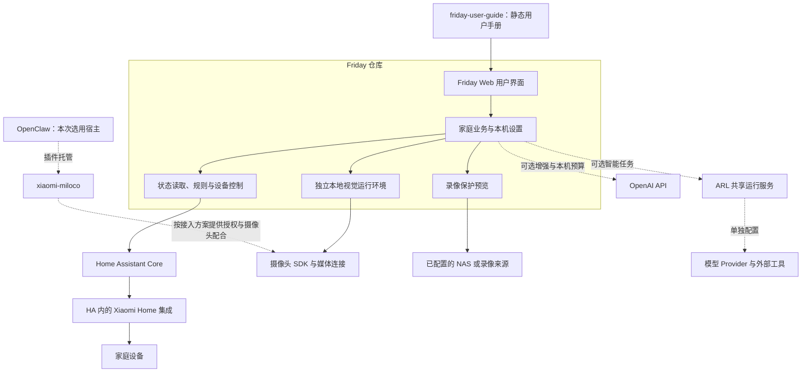
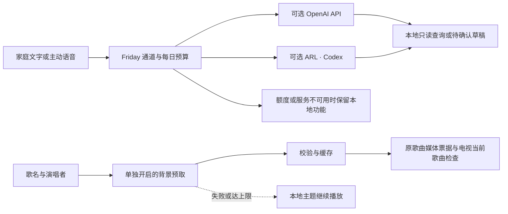
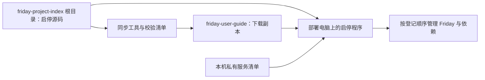
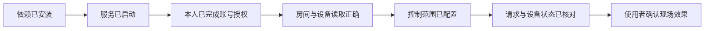

# Friday 整体架构与仓库关系

本页帮助维护人员判断能力属于哪个仓库、依赖安装在哪里，以及哪些结果需要分别验收。

## 用户入口与运行组件

## 哪些是独立服务

| 组件 | 运行位置 | 容易混淆的点 |
| --- | --- | --- |
| Friday | 独立本机 Web 服务，含可选工作进程 | 本地视觉代码在 Friday 仓库，但依赖和模型仍需另行准备 |
| HA | 独立家庭服务 | macOS 上的 HA Container 使用 Linux 虚拟机；网页能打开不证明全部无线发现能力 |
| Xiaomi Home | HA 内部集成 | 不需要作为另一套 Web 服务独立启动 |
| Miloco | 按官方插件平台部署 | 小米账号与摄像头服务就绪，不自动替 Friday 安装识别环境 |
| OpenClaw | 可选的插件宿主 | 本次使用，不代表所有 Miloco 方案都强制使用它 |
| ARL | 可选智能运行服务 | 普通本地手势不依赖其云端模型任务 |
| OpenAI API | 可选云端服务，Friday 服务端保管已有 Key | 各能力单独开启；本机用量上限不等于整个账户账单余额 |
| 用户手册 | GitHub Pages 静态站点 | 阅读文档不会连接任何家庭账号或控制设备 |

## 部署维护代码的归属

智能通道、用量账本和降级由 Friday 主仓维护。ARL 的 SDK 与原生回执保留原协议，API 结果不能冒充 ARL 原生确认。用户手册负责设置步骤、FAQ 与示例截图；本索引只记录组件关系。

Responses 负责受约束解释，Decisions 仍是影子建议，Realtime 转写经用户核对后才发送，Image API 只接收歌名和演唱者。各层不新增设备权限。详细设置见[用户手册](https://lijunfeng722.github.io/friday-user-guide/guides/intelligence/)，技术范围见[Friday 智能通道](https://github.com/Geeprox/Friday/blob/main/docs/intelligence.md)。

Friday 主仓维护依赖安装器和对应回归测试。元仓库根目录维护日常启动、停止、重启入口及服务管理程序，scripts/ 维护隔离测试和下载同步工具。用户手册提供同内容下载副本及操作说明；程序在部署电脑执行，服务清单与账号保存在本机私有目录。具体文件、顺序、升级原因和验收记录见[部署维护总览](operations.md)。

## 按层记录验收

同一个“成功”不能跨层推定结果。摄像头播放、人体识别、规则保存、指令发送、状态回读和现场动作分别记录；合成回归仅证明相应软件路径。

## 设备动作的两种来源

设备页与手势规则使用 Friday 配置的目标和控制范围。米家一键场景按照上游场景的整组内容执行，是独立的手动入口，涉及设备可能更多；不要把逐台 HA 控制授权说明套用到场景范围。使用前应在确认界面核对名称与设备数量。

## 如何随项目变化更新

新增仓库先填写职责、必要关系和官方入口；业务能力改变时，先更新产品源码，再更新手册任务页，最后修订本索引的关系说明。详见[维护方式](maintenance.md)。
