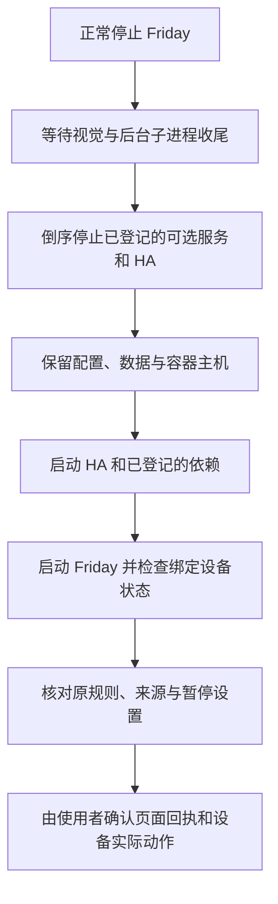

# 部署、启停与升级总览

从本页找到 Friday 的安装、正常停止、重新启动、依赖升级和故障排查入口，并了解哪些检查已完成。具体操作面向自己的 macOS / Linux 环境；机器路径、容器标识和家庭设备使用自己的配置。

## 文档和脚本分别存在哪里

| 内容 | 维护位置 | 使用入口 |
| --- | --- | --- |
| Friday 应用、业务和本地视觉代码 | [Friday](https://github.com/Geeprox/Friday) | 产品 README 与部署文档 |
| 安装教程、日常操作和常见问题 | [friday-user-guide 文档源码](https://github.com/lijunfeng722/friday-user-guide/tree/main/docs) | [在线用户手册](https://lijunfeng722.github.io/friday-user-guide/) |
| 可下载的启停与依赖维护脚本 | [friday-user-guide 脚本源码](https://github.com/lijunfeng722/friday-user-guide/tree/main/docs/assets/scripts) | 用户手册提供下载与校验步骤 |
| 跨仓库关系、维护入口和版本说明 | 本元仓库 | [总索引](../README.md)、[架构](architecture.md)及本页 |
| 本机服务清单、账号、规则、备份和原始诊断 | 自己部署环境的私有目录 | 由本机维护者管理，不提交到公开仓库 |

**GitHub Pages 是文档与下载站点。** 启停脚本由你下载后在部署电脑执行，站点本身不连接家庭或运行服务。本元仓库引用同一份公开脚本，避免分别复制后版本不一致。

Friday 应用源码中的自带安装器与这里发布的独立维护工具可能处于不同版本。按用户手册下载更新工具，并显式指定已有 Friday 安装目录；不能因为本机有源码修改，就认为上游仓库也已经发布该修改。

## 按任务选择入口

| 任务 | 操作说明 |
| --- | --- |
| 全新 macOS 安装 | [准备工具、容器和 Friday](https://lijunfeng722.github.io/friday-user-guide/getting-started/installation-macos/) |
| 全新 Linux 安装 | [准备工具、Docker 和 Friday](https://lijunfeng722.github.io/friday-user-guide/getting-started/installation-linux/) |
| HA 与 Xiaomi Home | [设备接入目的、安装、账号授权与设备导入](https://lijunfeng722.github.io/friday-user-guide/getting-started/installation-home-assistant/) |
| 可选摄像头和本地识别 | [Miloco、视觉依赖及配置边界](https://lijunfeng722.github.io/friday-user-guide/getting-started/installation-camera/) |
| 已部署环境的停止、重启与状态检查 | [维护章节](https://lijunfeng722.github.io/friday-user-guide/getting-started/installation-maintenance/) |

已有 HA 时复用原实例。Xiaomi Home 安装在 HA 内，随 HA 启停；Miloco、插件宿主、ARL 与视觉环境按实际使用情况分别准备。

## 启停脚本与运行方式

| 文件 | 职责 |
| --- | --- |
| [friday-services.py](https://github.com/lijunfeng722/friday-user-guide/blob/main/docs/assets/scripts/friday-services.py) | 读取本机服务清单，提供 `init`、`start`、`stop`、`restart`、`status`，按归属与就绪检查管理服务 |
| [stop-friday.sh](https://github.com/lijunfeng722/friday-user-guide/blob/main/docs/assets/scripts/stop-friday.sh) | 请求正常停止，等待已登记服务与子进程收尾 |
| [restart-friday.sh](https://github.com/lijunfeng722/friday-user-guide/blob/main/docs/assets/scripts/restart-friday.sh) | 正常停止后按依赖顺序重新启动 |
| [SHA256SUMS](https://github.com/lijunfeng722/friday-user-guide/blob/main/docs/assets/scripts/SHA256SUMS) | 校验上述三个文件 |
| [setup-dependencies.py](https://github.com/lijunfeng722/friday-user-guide/blob/main/docs/assets/scripts/setup-dependencies.py) | 固定依赖来源和版本，支持 Xiaomi Home 来源预取、首次安装和显式离线升级 |
| [SETUP-SHA256SUMS](https://github.com/lijunfeng722/friday-user-guide/blob/main/docs/assets/scripts/SETUP-SHA256SUMS) | 校验依赖工具及其许可证 |

先按[用户手册](https://lijunfeng722.github.io/friday-user-guide/getting-started/installation-maintenance/#1-日常启动与停止)下载、校验并初始化自己的 `services.local.json`。已有交付包时直接使用原配置；macOS 的“优雅停止.command”“重新启动.command”可以调用同一管理程序。

对于按教程准备的通用目录，先在部署电脑进入脚本目录。Linux 使用 Docker sudo 时先 `sudo -v`，macOS 先确认原 Colima 实例可用。

```sh
cd "$HOME/friday-home/service-tools"
```

只查看重新启动计划：

```sh
FRIDAY_PYTHON="$HOME/friday-home/Friday/.venv/bin/python" ./restart-friday.sh --dry-run
```

需要正常停止时：

```sh
FRIDAY_PYTHON="$HOME/friday-home/Friday/.venv/bin/python" ./stop-friday.sh
```

需要重新启动时：

```sh
FRIDAY_PYTHON="$HOME/friday-home/Friday/.venv/bin/python" ./restart-friday.sh
```

查看当前状态：

```sh
"$HOME/friday-home/Friday/.venv/bin/python" friday-services.py status --config "$PWD/services.local.json"
```

基础配置默认管理 Friday Web，可显式纳入本教程的既有 HA 容器。完整部署只有将 Miloco、插件宿主、ARL 等登记到服务清单后才会管理它们；部署在其他电脑的服务按其原维护方式操作。



日常重启不自动更新依赖，不重新初始化账号，不逐台重复授权。已有暂停设置会保留。正常退出超时、进程归属不符或恢复检查失败时，脚本报告错误，停止继续本轮操作；以逐项输出确认哪些服务仍在运行。

## Xiaomi Home 版本与升级

本轮验证的组合为 HA **2026.10.4**、Xiaomi Home **v0.5.0**。集成固定官方提交 [`75b3acb6325a3a8d295688b13904737d6738a6a5`](https://github.com/XiaoMi/ha_xiaomi_home/commit/75b3acb6325a3a8d295688b13904737d6738a6a5)，用于复现这次维护结果，并不表示未来自动跟随最新版本。

旧版 v0.4.3 的云设备刷新在网络请求异常后可能没有安排重试，使设备状态持续不可用。官方 [PR #1555](https://github.com/XiaoMi/ha_xiaomi_home/pull/1555)补上异常后的重试，并随 [v0.4.6](https://github.com/XiaoMi/ha_xiaomi_home/releases/tag/v0.4.6)发布；本次采用的 [v0.5.0](https://github.com/XiaoMi/ha_xiaomi_home/releases/tag/v0.5.0)包含该修复。最初网络重置的来源仍未确定。

已有集成按[完整升级步骤](https://lijunfeng722.github.io/friday-user-guide/getting-started/installation-maintenance/#已有-xiaomi-home-怎样升级)操作：

1. 暂停互动，核对原 HA 容器和配置目录，提前下载并校验集成来源。
2. 正常停止同一套服务，在停止状态备份完整 HA 配置（含 `.storage`）和 Friday 私有设置。
3. 执行工具的 `xiaomi-home-upgrade`，显式指定原容器；工具核对停止状态及配置挂载，保留旧组件备份，仅替换集成文件。
4. 上线后核对集成已加载、原实体标识、规则和允许控制范围，以及目标设备正常且未过期的状态。
5. 按原意恢复互动，由使用者验证一次页面回执与实物动作。

文件替换失败时工具恢复旧组件。上线后若需回滚版本迁移，先停机，再恢复完整 HA 备份和相应 Friday 配置；仅换回旧 Python 文件不足以恢复全部注册表数据。

## 重启成功要检查到哪一层

| 检查 | 能说明什么 |
| --- | --- |
| 进程、端口和 Web 页面可用 | 对应服务已运行 |
| HA 原集成已加载、真实家庭来源已激活 | 账号与家庭读取链路可用 |
| 启用规则的目标仍在允许范围，状态正常且未过期 | 绑定设备满足启动就绪检查 |
| 摄像头画面、识别及原互动开关正常 | 对应视觉运行链路已恢复 |
| 页面显示成功，使用者观察到实物动作 | 本次选定规则的现场验收通过 |

管理程序在 `ready` 配置中启用 `verify_saved_gestures: true` 时，会检查当前启用手势规则的绑定设备。目标只出现在设备列表里不能通过检查；不可用或过期时继续等待，超时报告未就绪。已暂停的互动保留暂停设置，上线后的现场验收仍需按需完成。

如果已有手势响应却设备没动，先看 HA 中目标是否“不可用”，再检查 Xiaomi Home 连接和日志。网络恢复后可以重新加载原集成，再核对状态；具体入口见[重启后设备连接排查](https://lijunfeng722.github.io/friday-user-guide/getting-started/installation-maintenance/#重启后有手势记录设备却没动)。

## 本轮维护与验收记录

| 日期 | 修改或验证 | 范围 |
| --- | --- | --- |
| 2026-10-31 | 启停管理程序补充绑定设备就绪检查 | macOS 与隔离 Linux 的进程、状态与错误路径检查；不代替全新 Linux 的视觉实体验收 |
| 2026-10-31 | 安装工具固定 Xiaomi Home v0.5.0，补充来源核对、显式离线升级和替换失败恢复 | 10 项安装器与 18 项相关发布输入检查通过；隔离 HA 迁移预演保留原实体标识和设备关联 |
| 2026-10-31 | 实际正常下线、完整备份、升级和上线 | macOS 部署中原规则、控制范围和摄像头配置保留；绑定设备状态与摄像头服务恢复 |
| 2026-11-01 | 使用者确认“双臂张开 → 合上”后，页面显示成功、窗帘实际动作 | 本次既有窗帘规则的重启后实体验收通过，不扩展为所有设备或平台均通过 |

上述公开维护工具与详细教程已发布于用户手册仓库的提交 [`b5e0815`](https://github.com/lijunfeng722/friday-user-guide/commit/b5e0815a861248ba8365bed5f65facd05a395602)。原始诊断、账号、设备清单及备份保留在本机私有目录；公开说明只记录问题、处理方法和验证范围。

后续修改脚本时，同步该仓库的校验清单、用户教程和本站入口；更新要求见[维护索引](maintenance.md)。
